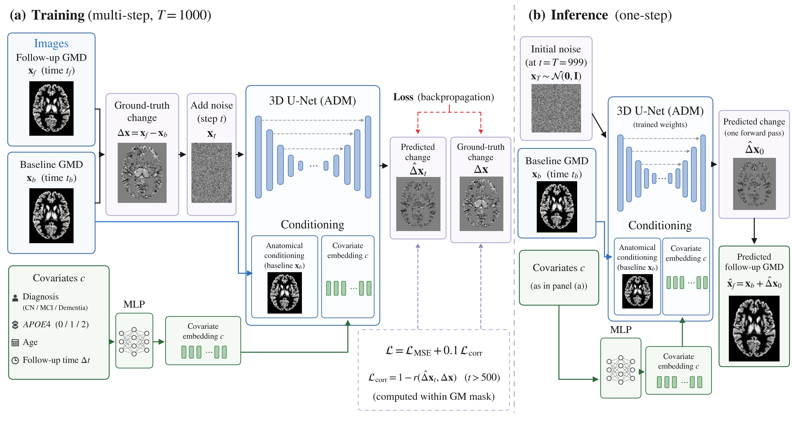
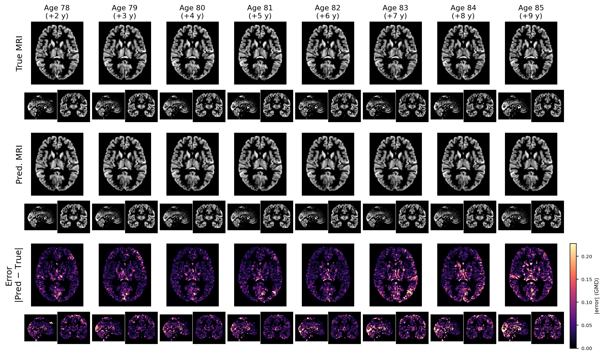

# OneStepBrainMRI

Conditional 3D diffusion for individualised prediction of grey-matter atrophy
from a single baseline brain MRI. One model covers nine follow-up horizons
(2 to 10 years). The interval is a continuous conditioning input rather than a
separate model per horizon. Inference is a single forward pass.



[Installation](#installation) • [Data](DATA.md) • [Training](#training) • [Inference](#inference) • [Weights](#model-weights) • [Cite](#citing)

---

## Table of Contents

- [Installation](#installation)
- [Data preparation](DATA.md)
- [Training](#training)
- [Inference](#inference)
- [Evaluation](#evaluation)
- [Model weights](#model-weights)
- [Acknowledgements](#acknowledgements)
- [Citing](#citing)

---

## Installation

```bash
git clone https://github.com/natenaile/OneStepBrainMRI.git
cd OneStepBrainMRI
pip install -r requirements.txt
export PYTHONPATH=$PWD/src:$PWD:$PYTHONPATH
```

Tested with Python 3.12 and PyTorch 2.10.

---

## Data preparation

See [DATA.md](DATA.md) for the expected inputs: CAT12 modulated grey-matter
maps, the `pairs_tier1.csv` schema, and the two normalisation constants that
must not be re-estimated when using pretrained weights.

---

## Training

Set the `/path/to/...` placeholders in the config first. The training and
inference scripts read their paths from the YAML file.

```bash
python src/scripts/train.py --config src/scripts/config/train_main.yaml
```

Multi-GPU via `torchrun`; `batch_size` in the config is **per GPU**.

| config | what differs from the main model |
|---|---|
| `train_main.yaml` | (reference) |
| `train_abl_no_corr_loss.yaml` | `corr_weight: 0.0` |
| `train_abl_no_covariates.yaml` | `zero_cond_slots: "0,1,2,3,4"` |
| `train_abl_predict_image.yaml` | `predict_target: true` |


## Inference

```bash
python src/scripts/sample.py --config src/scripts/config/infer_main.yaml
```

A single forward pass at t = T (DDIM, η = 0): **1.45 s per volume** on one
NVIDIA GH200, 1.80 s end-to-end including NIfTI read and write, measured over
1,568 test pairs.

Repeated runs on the same hardware give bit-identical output. Results may
differ slightly across GPU architectures, as the CUDA random number stream and
convolution algorithm selection are device-dependent.

---

## Results



True and predicted follow-up scans for one test subject across eight follow-up
intervals, with the voxel-wise error below.

---

## Evaluation

```bash
python src/scripts/evaluate.py \
    --pred  /path/to/output/<run_id> \
    --csv   /path/to/data/pairs_tier1.csv \
    --scans /path/to/data/scans \
    --atlas /path/to/neuromorphometrics_1.5mm.nii
```

Reports global and regional metrics by interval. The atlas must be resampled to
match the data geometry (113×137×113 at 1.5 mm); each regional ROI is
intersected with the grey-matter mask.

---

## Model weights

Model weights are **not publicly distributable** under the ADNI Data Use
Agreement. Researchers with their own ADNI access may request them from the
authors.

---

## Acknowledgements

Built on OpenAI's [guided-diffusion](https://github.com/openai/guided-diffusion)
(Dhariwal & Nichol, *Diffusion Models Beat GANs on Image Synthesis*, NeurIPS
2021), which provides the ADM UNet and the DDPM machinery.

Specific to this work: 3D adaptation of the network and the diffusion process;
the baseline scan concatenated as an unnoised second input channel; a
six-dimensional covariate vector injected into the timestep embedding;
x₀-parameterisation, so the network predicts the target directly rather than
the noise; the target being the grey-matter change map rather than the
follow-up image; a grey-matter-masked objective combining MSE with a Pearson
correlation term; and single-pass inference at t = T. The classifier-guidance
components of the original are not used and have been removed.

Data from [ADNI](https://adni.loni.usc.edu/) and [AIBL](https://aibl.org.au/).
Computation on [CSC](https://csc.fi/) resources.

---

## Citing

```bibtex
@misc{shiferaw2026onestep,
  title  = {TITLE},
  author = {Shiferaw, Natenaile Asmamaw and Tohka, Jussi},
  year   = {2026}
}
```

---

## Licence

MIT, see [LICENSE](LICENSE). The licence covers the source code only. It does
not extend to the ADNI or AIBL imaging data, or to weights trained on it.
